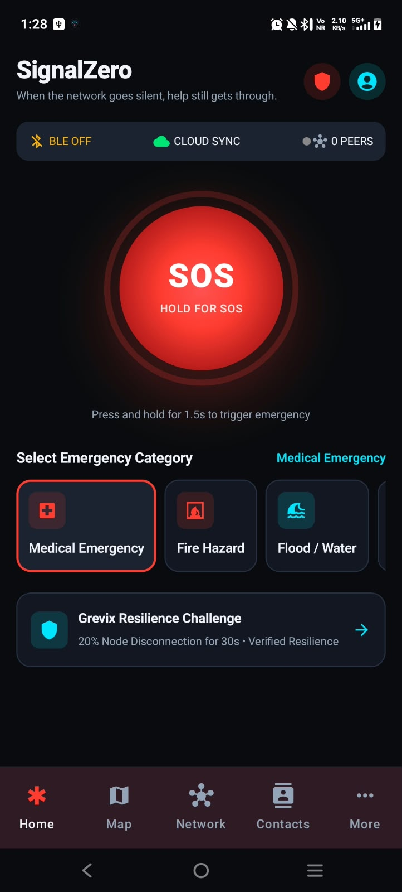
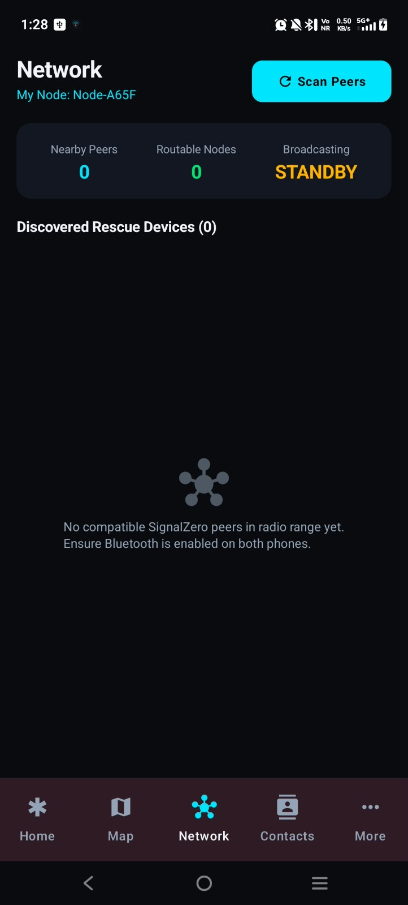
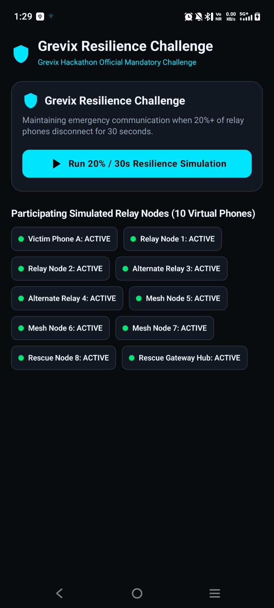
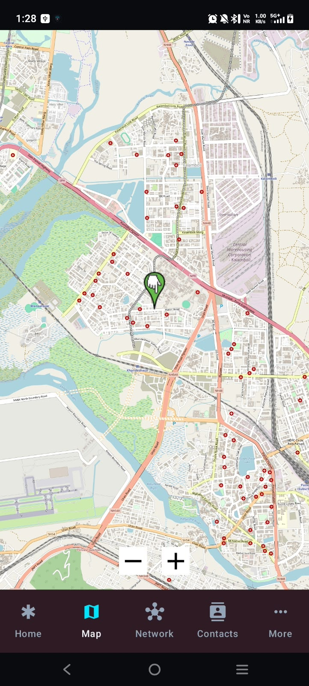
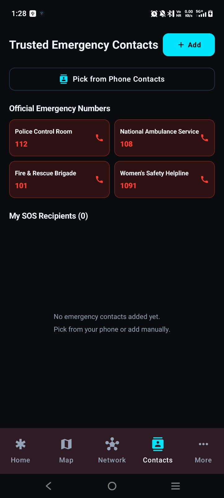
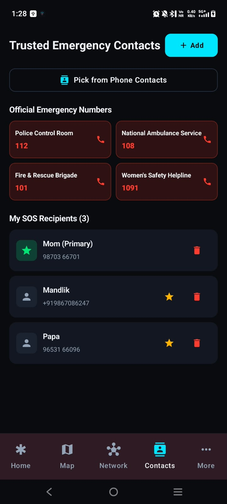
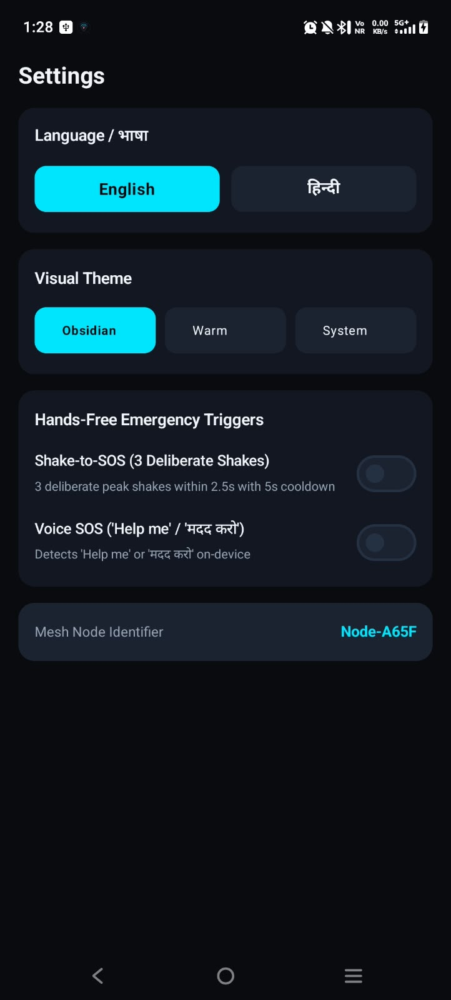
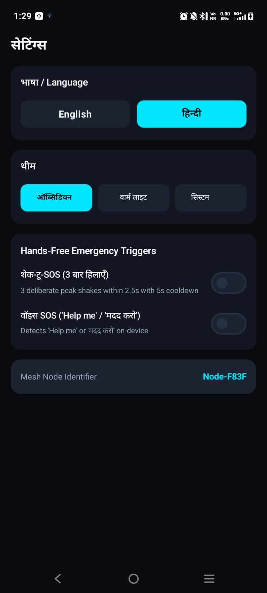
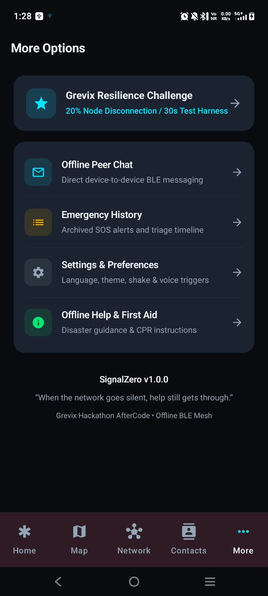
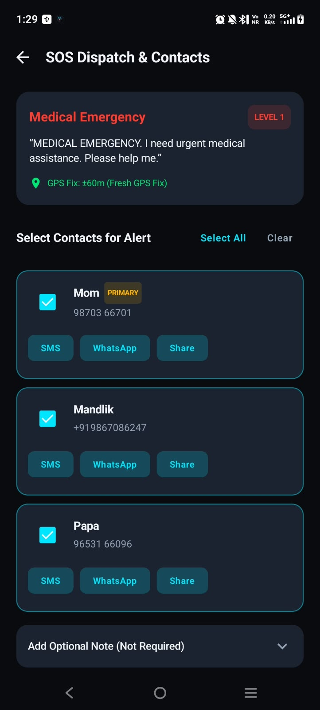

# SignalZero

**When the network goes silent, help still gets through.**

SignalZero is a native Android emergency communication prototype for the Grevix AfterCode challenge. It creates SOS records locally, attempts nearby Bluetooth Low Energy (BLE) transport between compatible installations, and supports trusted-contact notification and optional Firebase synchronization.

[Download Android APK](https://github.com/corsal2006/SignalZero/releases/latest) · [Demo video](docs/media/video/signalzero-demo.mp4) · [How it works](docs/HOW_IT_WORKS.md) · [Build and verification](docs/BUILD_AND_VERIFICATION.md)

## Screenshots

  

<details>
<summary>More screenshots</summary>

      

</details>

The ten screenshots and MP4 were supplied in the WhatsApp ZIP. [Open or download the full demo](https://github.com/corsal2006/SignalZero/raw/refs/heads/main/docs/media/video/signalzero-demo.mp4).

## Features

- Category-based SOS with English and Hindi templates, optional notes, and location when available.
- Room persistence for incidents, chat, peers, contacts, and packet queues; DataStore preferences.
- BLE advertising, discovery, GATT transport, nearby chat, and SOS forwarding attempts.
- Trusted contacts, SMS permission-based dispatch, SMS composer/share fallback, and emergency calling intents.
- OpenStreetMap UI through osmdroid; GPS through Google Play services.
- Optional Firebase email/Google authentication and Firestore incident synchronization.
- Explainable local rule-based triage and a Grevix resilience demonstration.

## Install and try

1. Download `SignalZero-1.0.0-debug.apk` from [Releases](https://github.com/corsal2006/SignalZero/releases/latest).
2. Install it on Android 8.0 (API 26) or newer. Allow installation from the app opening the APK if Android prompts you.
3. Open SignalZero and grant the permissions needed for the features you use. Enable Bluetooth on both phones for nearby communication.
4. Add trusted contacts, choose an SOS category, and follow the on-screen hold/confirmation flow. Test contact sending only with recipients expecting a test alert.
5. For a BLE demo, use two compatible physical phones, disable internet, discover a peer, and try messaging and SOS. Inspect actual delivery states and reconnection behavior.

The downloadable artifact is a **debug-signed demonstration APK**, not a production-signed distribution. Physical-device installation and end-to-end BLE delivery have not been independently verified in this publishing session.

## Build from source

Use Android Studio with JDK 17 and Android SDK 34. The checked-in wrapper uses Gradle 8.13. Create `local.properties` with your SDK path if Android Studio does not generate it.

For Firebase, register `com.signalzero.app` in your own Firebase project and place its Android client configuration at `app/google-services.json` (excluded from Git). Enable the authentication providers you need, register signing fingerprints for Google sign-in, and configure Firestore access rules. The Google Services build plugin requires this file. The supplied APK uses the existing local Firebase configuration; that configuration is not published in source. The manifest also contains the original Firebase auth-link host; change it for your deployment.

```powershell
.\gradlew.bat testDebugUnitTest assembleDebug
```

```sh
chmod +x gradlew
./gradlew testDebugUnitTest assembleDebug
```

APK output: `app/build/outputs/apk/debug/app-debug.apk`. See [build notes](docs/BUILD_AND_VERIFICATION.md) for verification results and production signing requirements.

## File structure

```text
SignalZero/
├── app/
│   ├── build.gradle.kts
│   └── src/
│       ├── main/
│       │   ├── AndroidManifest.xml
│       │   ├── java/com/signalzero/app/
│       │   │   ├── challenge/       # Virtual-node resilience demo
│       │   │   ├── core/            # Constants and localization
│       │   │   ├── data/            # Room, models, repositories, preferences
│       │   │   ├── mesh/            # BLE discovery, GATT, queue and routing
│       │   │   ├── service/         # SOS, location, contacts, triage, sync
│       │   │   └── ui/              # Compose screens, navigation, themes
│       │   └── res/                 # Android resources and icons
│       └── test/                    # JVM unit tests
├── docs/
│   ├── media/screenshots/           # 10 supplied screenshots
│   ├── media/video/                 # Supplied MP4 demo
│   ├── HOW_IT_WORKS.md
│   └── BUILD_AND_VERIFICATION.md
├── gradle/wrapper/
├── gradlew / gradlew.bat
├── build.gradle.kts
└── settings.gradle.kts
```

## Prototype limitations

BLE requires a compatible reachable peer, permissions, and suitable hardware/background conditions. Saving an SOS locally does not prove delivery to a contact, server, or responder. SMS still needs cellular service. Map tiles may need internet unless already cached. Triage is deterministic code, with no integrated external AI model.

The resilience screen disconnects two of ten virtual nodes for a timed scenario. Most report metrics are preset values and counters, not measured real packet routing or radio performance. Its PASS result is demonstration output. Read [the implementation notes](docs/HOW_IT_WORKS.md) before citing it as evidence.

This prototype has no demonstrated integration with an official emergency dispatch service. Current repository documentation describes the inspected implementation.
