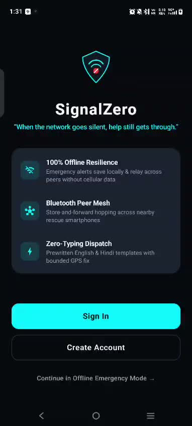
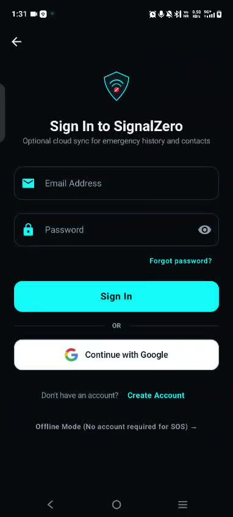
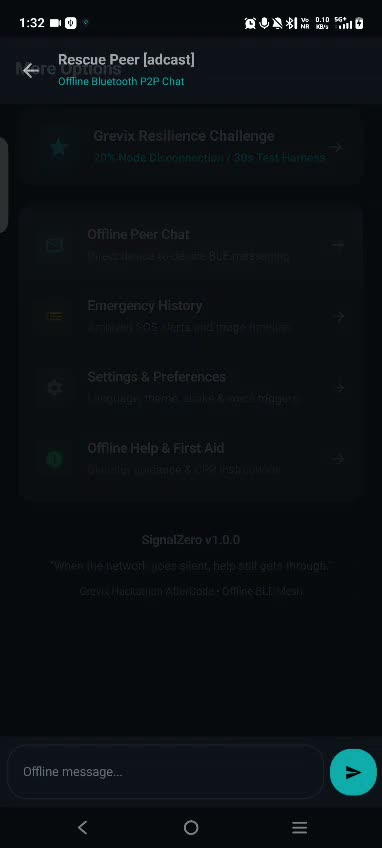
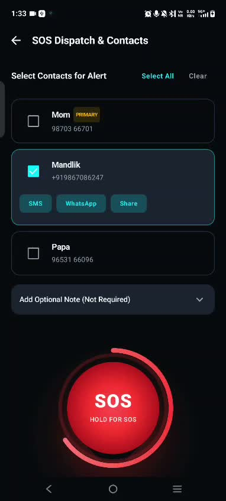
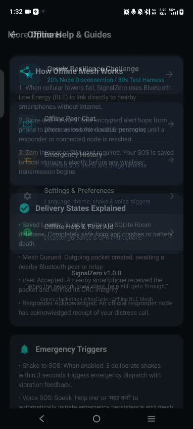

# SignalZero

**When the network goes silent, help still gets through.**

SignalZero is a native Android emergency communication prototype for the Grevix AfterCode challenge. It creates SOS records locally, attempts nearby Bluetooth Low Energy (BLE) transport between compatible installations, and supports trusted-contact notification and optional Firebase synchronization.

[Download Android APK](https://github.com/corsal2006/SignalZero/releases/latest) · [Demo video](docs/media/video/signalzero-demo.mp4) · [How it works](docs/HOW_IT_WORKS.md) · [Build and verification](docs/BUILD_AND_VERIFICATION.md)

## Demo video

**[▶ Watch / download the SignalZero demo (1 minute 39 seconds)](https://github.com/corsal2006/SignalZero/raw/refs/heads/main/docs/media/video/signalzero-demo.mp4)**

<a href="https://github.com/corsal2006/SignalZero/raw/refs/heads/main/docs/media/video/signalzero-demo.mp4"></a>

The preview links to the supplied MP4. You can also [open its GitHub file page](https://github.com/corsal2006/SignalZero/blob/main/docs/media/video/signalzero-demo.mp4). The recording covers sign-in, SOS, the virtual-node challenge screen, maps, contacts, settings, help, peer chat, and incident details. Recorded UI states alone do not establish end-to-end delivery.

## Screenshot gallery

All ten original app screenshots are displayed below, together with five additional frames extracted from the supplied demo video.

### Welcome and offline entry



### Sign-in, SOS, and map

| Sign-in: email / Google / offline mode | SOS home | Incident map |
| --- | --- | --- |
|  |  |  |

### Trusted contacts and SOS dispatch

| Contacts setup | Saved contacts | SOS dispatch and contact selection |
| --- | --- | --- |
|  |  |  |

### BLE network, chat, and incident history

| Nearby network | Offline peer chat | Incident details and status timeline |
| --- | --- | --- |
|  |  |  |

### Settings, languages, and hands-free triggers

| English settings | Hindi settings |
| --- | --- |
|  |  |

### Challenge, help, and more options

| Grevix resilience demonstration | Offline help and guides | More options |
| --- | --- | --- |
|  |  |  |

## Features

- Category-based SOS with English and Hindi templates, optional notes, and location when available.
- Room persistence for incidents, chat, peers, contacts, and packet queues; DataStore preferences.
- BLE advertising, discovery, GATT transport, nearby chat, and SOS forwarding attempts.
- Trusted contacts, SMS permission-based dispatch, SMS composer/share fallback, and emergency calling intents.
- OpenStreetMap UI through osmdroid; GPS through Google Play services.
- Optional Firebase email/Google authentication and Firestore incident synchronization.
- Explainable local rule-based triage and a Grevix resilience demonstration.

## Technology stack and tools

| Area | Technology used | Role |
| --- | --- | --- |
| Language and runtime | Kotlin 1.9.24, JDK 17 | Native Android implementation |
| UI | Jetpack Compose, Material 3, Compose BOM 2024.06.00 | Screens, themes, bilingual interface |
| State and architecture | ViewModel, Navigation Compose, coroutines 1.8.1, Flow | Navigation and asynchronous state |
| Local storage | Room 2.6.1, KSP, Preferences DataStore 1.1.1 | Incidents, contacts, chat, peers, packet queue, settings |
| Nearby communication | Android Bluetooth LE, advertising/scanning, GATT client/server | Discovery and packet transfer attempts |
| Maps and location | osmdroid 6.1.18 / OpenStreetMap, Play services location 21.3.0 | Map rendering and location capture |
| Authentication | Firebase Auth, Google Play services auth 21.2.0 | Email/password and Google sign-in |
| Cloud storage | Cloud Firestore, Firebase BOM 33.7.0 | Optional incident synchronization |
| Hands-free input | Accelerometer / SensorManager, Android SpeechRecognizer | Shake and recognized-phrase SOS triggers |
| Contact workflows | Android contacts picker, SmsManager, SMS/share/call intents | Select contacts and attempt notifications |
| Background infrastructure | Foreground BLE service; WorkManager dependency | Relay service; WorkManager is declared in Gradle |
| Tests and build | JUnit 4.13.2, coroutine test utilities, Gradle 8.13, AGP 8.13.2 | JVM tests and APK packaging |
| Development assistance | ChatGPT / Codex; Antigravity IDE reported in the supplied project draft | Engineering/documentation assistance; not a runtime dependency |

`AiTriageEngine` uses deterministic category and proximity rules. No trained model or external AI API is integrated into that engine. The Gradle files are the authoritative dependency list.

## Grevix AfterCode challenges and project evolution

Challenge numbering here follows the supplied context: **the emailed relay-disconnection card is Challenge 1; the LinkedIn feedback is Challenge 2**. [Grevix AfterCode event page](https://unstop.com/hackathons/grevix-aftercode-grevix-1755080) · [LinkedIn feedback post](https://www.linkedin.com/feed/update/urn:li:activity:7515019388048293888/).

### Challenge 1 — Email: temporary relay nodes disconnect

The emailed card describes disaster conditions where participating phones stop acting as relay nodes because battery runs low or Bluetooth/Wi-Fi is disabled. The requirement is to detect and adapt to temporary or permanent disconnection, balance freshness against lost packets/connections, and preserve ordinary SOS and incident processing. Its target demonstration is **at least 20% of participating phones disconnected for 30 seconds**, without compromising incident response accuracy or timeliness.

SignalZero addresses this through local-first incident storage, peer health tracking, a persistent packet queue, and forwarding attempts when eligible peers become available. The challenge screen depicts two of ten virtual nodes disconnecting for thirty logical seconds and reconnecting.

**Evidence boundary:** the virtual-node report contains preset metrics and counters. It is a demonstration of the scenario, not proof that the email's physical-network performance requirement has been met. Real multi-phone outage/recovery measurements remain necessary.

### Challenge 2 — LinkedIn feedback: hands-free SOS and smarter mesh

The supplied feedback screenshot shows two requests:

- **Atharva Mandlik:** add an SOS trigger through three shakes or a recognized help phrase, include location and emergency type, protect against accidental activation, and support reliable background behavior.
- **Shushal Borugadda:** improve offline emergency relaying, reroute when devices disconnect, recover queued alerts when connections return, and prioritize critical incidents by severity. The visible comment is truncated; only the visible requirements are summarized here.

| Feedback | Implementation response | Current limit |
| --- | --- | --- |
| Three-shake SOS | `ShakeDetector`: three above-threshold events within 2.5 seconds, rebound filtering, five-second cooldown; settings toggle | Hardware and background behavior require device testing |
| Voice help phrase | `VoiceSosDetector`: English/Hindi help phrases, recognition availability check, six-second cooldown; microphone permission | Depends on the device speech provider; offline/continuous listening is not guaranteed |
| Location and emergency type | Localized category template and bounded location capture in the SOS flow | Location may be unavailable |
| Relay and recovery | BLE/GATT components, peer registry, Room packet queue, periodic forwarding attempts | Routing/retry limitations remain documented |
| Severity prioritization | Local triage assigns severity and rationale | Queue draining does not implement a verified severity-priority scheduler |

Hands-free detectors are started according to user preferences in `MainActivity` and stopped when it is destroyed. Reliable operation while locked or across all background restrictions has not been established. These additions evolve the original SOS flow toward the feedback goals without making cloud AI a prerequisite for local incident capture.

## How an SOS works

1. A manual or enabled hands-free trigger starts the incident flow.
2. The app attempts a bounded location lookup and constructs the localized category message.
3. Deterministic triage assigns severity; Room saves the incident before transmission.
4. A BLE packet is queued and an eligible nearby peer is selected when available.
5. Trusted-contact notification and optional Firestore synchronization are attempted through their respective channels.

Saving locally, handing a packet to a peer, submitting SMS, and storing in Firestore are different outcomes. [Detailed implementation and known limitations](docs/HOW_IT_WORKS.md) · [Build verification and decision log](docs/BUILD_AND_VERIFICATION.md).

## Install and try

1. Download `SignalZero-1.0.0-debug.apk` from [Releases](https://github.com/corsal2006/SignalZero/releases/latest).
2. Install it on Android 8.0 (API 26) or newer. Allow installation from the app opening the APK if Android prompts you.
3. Open SignalZero and grant the permissions needed for the features you use. Enable Bluetooth on both phones for nearby communication.
4. Add trusted contacts, choose an SOS category, and follow the on-screen hold/confirmation flow. Test contact sending only with recipients expecting a test alert.
5. For a BLE demo, use two compatible physical phones, disable internet, discover a peer, and try messaging and SOS. Inspect actual delivery states and reconnection behavior.

The downloadable artifact is a **debug-signed demonstration APK**, not a production-signed distribution. Physical-device installation and end-to-end BLE delivery have not been independently verified in this publishing session.

## Build from source

Use Android Studio with JDK 17 and Android SDK 34. The checked-in wrapper uses Gradle 8.13. Create `local.properties` with your SDK path if Android Studio does not generate it.

For Firebase, register `com.signalzero.app` in your own Firebase project and place its Android client configuration at `app/google-services.json` (excluded from Git). Enable the authentication providers you need, register signing fingerprints for Google sign-in, and configure Firestore access rules. The Google Services build plugin requires this file. The supplied APK uses the existing local Firebase configuration; that configuration is not published in source. The manifest also contains the original Firebase auth-link host; change it for your deployment.

```powershell
.\gradlew.bat testDebugUnitTest assembleDebug
```

```sh
chmod +x gradlew
./gradlew testDebugUnitTest assembleDebug
```

APK output: `app/build/outputs/apk/debug/app-debug.apk`. See [build notes](docs/BUILD_AND_VERIFICATION.md) for verification results and production signing requirements.

## File structure

```text
SignalZero/
├── app/
│   ├── build.gradle.kts
│   └── src/
│       ├── main/
│       │   ├── AndroidManifest.xml
│       │   ├── java/com/signalzero/app/
│       │   │   ├── challenge/       # Virtual-node resilience demo
│       │   │   ├── core/            # Constants and localization
│       │   │   ├── data/            # Room, models, repositories, preferences
│       │   │   ├── mesh/            # BLE discovery, GATT, queue and routing
│       │   │   ├── service/         # SOS, location, contacts, triage, sync
│       │   │   └── ui/              # Compose screens, navigation, themes
│       │   └── res/                 # Android resources and icons
│       └── test/                    # JVM unit tests
├── docs/
│   ├── media/screenshots/           # 10 originals + 5 demo video frames
│   ├── media/video/                 # Supplied MP4 demo
│   ├── HOW_IT_WORKS.md
│   └── BUILD_AND_VERIFICATION.md
├── gradle/wrapper/
├── gradlew / gradlew.bat
├── build.gradle.kts
└── settings.gradle.kts
```

## Prototype limitations

BLE requires a compatible reachable peer, permissions, and suitable hardware/background conditions. Saving an SOS locally does not prove delivery to a contact, server, or responder. SMS still needs cellular service. Map tiles may need internet unless already cached. Triage is deterministic code, with no integrated external AI model.

The resilience screen disconnects two of ten virtual nodes for a timed scenario. Most report metrics are preset values and counters, not measured real packet routing or radio performance. Its PASS result is demonstration output. Read [the implementation notes](docs/HOW_IT_WORKS.md) before citing it as evidence.

This prototype has no demonstrated integration with an official emergency dispatch service. Current repository documentation describes the inspected implementation.
