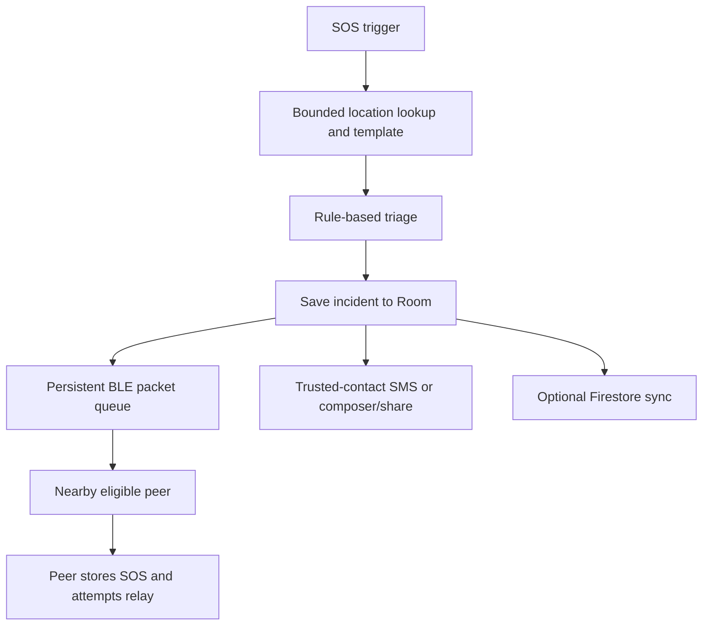

# How SignalZero works

## SOS lifecycle

`EmergencyOrchestrator` applies a five-second trigger debounce and creates an incident ID. It requests location with an eight-second bound, falls back to unavailable location, and builds the selected localized emergency template plus an optional note. `AiTriageEngine` assigns category-based severity and checks nearby incidents of the same category for clustering. The evaluated incident is saved through Room before any transmission attempt.

Next, the orchestrator enqueues an SOS packet, attempts trusted-contact notification, and tries Firebase synchronization if Android reports an internet-capable network. Local records remain available when transmission fails.

## Nearby communication

BLE scanner and advertiser components discover compatible installations. GATT client/server components exchange serialized JSON packets. `MeshRouter` stores outgoing packets and chooses the first eligible unvisited peer. A worker retries pending packets every ten seconds, processing up to three per cycle when peers exist. Transfer callbacks update local incident/chat status; incoming SOS packets are stored and may be forwarded.

Packets contain an ID, type, origin, target where applicable, timestamps, payload, hop count, and visited nodes. Defaults are five maximum hops and one-hour expiry. Incoming packets are checked for duplicate IDs and expiry. These fields express routing intentions; this prototype does not fully enforce every constraint in every retry path. The persisted relay packet is not updated with the incremented hop/visited metadata before later retries, and queued chat retries use the generic forwarding path rather than a demonstrated end-to-end private routing protocol.

Transport callback success must not be interpreted as confirmed rescue or recipient action. No independently verified multi-phone radio test is included in this publication.

## Contacts, location, and cloud

With SMS permission, the notification service attempts multipart SMS to opted-in contacts. Its count records submission to Android's SMS API, with no delivery pending intents attached. Otherwise it opens an SMS composer, falling back to sharing. Phone calls use a direct call when permitted or the dialer otherwise.

Location is optional; an SOS can retain an unavailable location state. osmdroid displays OpenStreetMap tiles, which are not guaranteed offline without cached data. Firebase provides optional account and Firestore support, requiring deployment configuration and appropriate rules.

There is a known status limitation: the orchestrator marks `RECEIVED_BY_SERVER` after calling the sync method, while that method can catch per-record failures and return zero. Therefore that UI status alone is insufficient evidence that Firestore stored the incident.

## Grevix challenge evolution

The first challenge is represented by local SOS capture, templates, contacts, location, and nearby transport. The second adds resilience concepts: persistent queues, peer health, forwarding, and a virtual-node disconnection demonstration.

`GrevixResilienceSimulator` has ten predefined virtual nodes and marks two disconnected for thirty logical seconds. It waits through the scenario and reconnects them. Its latency percentiles, packet delivery counts, route changes, and PASS status are hard-coded report fields; duplicate suppression is an incremented counter. Recovery time measures a coroutine delay. It does not send simulated packets through the injected mesh router. This is a UI demonstration, not a validated network benchmark.

## Technology

Kotlin 1.9.24, Jetpack Compose/Material 3, coroutines and Flow, ViewModels, Room 2.6.1 with KSP, DataStore, Android BLE/GATT APIs, Google Play location/auth, Firebase Auth/Firestore, osmdroid, and JUnit. Dependencies in the Gradle files are the authoritative version list. No external AI service is used for triage.
